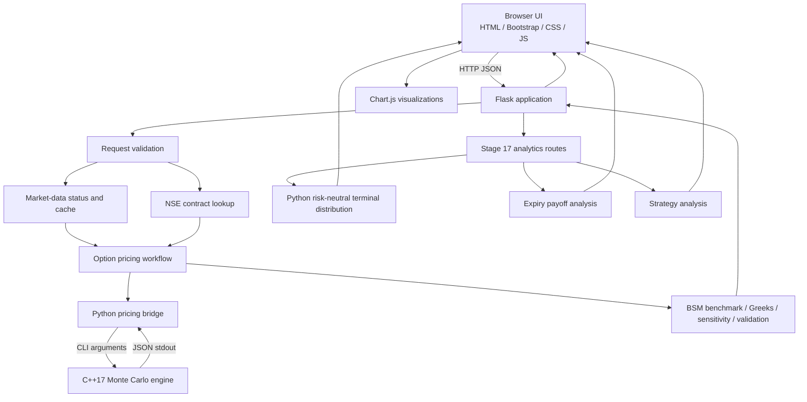

# OptionLab — Architecture and Implementation Map

## 1. System boundary

OptionLab is a local web application for theoretical pricing and analysis of European-style NSE stock options. It does not retrieve traded option-chain prices, infer implied volatility from the option market, submit orders or manage positions.

## 2. Component architecture

## 3. Data flow

### 3.1 Underlying market data

1. The TejHQ client fetches raw OHLCV and adjusted historical observations.
2. CSV-storage services validate and save records under `data/cache/`.
3. The raw file provides the latest raw close used as spot.
4. The adjusted file provides adjusted closes used to calculate historical log returns and annualized volatility.
5. Market-data status checks file availability, schema, instrument identity, numeric validity, duplicate/ordered dates, latest-date alignment and age.
6. Pricing must reject missing, invalid or raw/adjusted latest-date-mismatched data. Aging/stale data can be allowed with warnings according to the application's policy.

Default cache naming:

- `data/cache/nse_<SYMBOL>.csv`
- `data/cache/nse_<SYMBOL>_adjusted.csv`

Different historical start dates or record counts are allowed; the latest observation dates must agree for the matched cache to be accepted for pricing.

### 3.2 NSE contract metadata

1. An NSE F&O contract-master snapshot is imported locally.
2. The importer selects stock-option (`OPTSTK`) records.
3. Strike fields are converted from paise to rupees.
4. NSE expiry timestamps are converted using the NSE epoch (1 January 1980 UTC).
5. `CE`/`PE` map to Call/Put.
6. Contract ID, expiry, strike, option type, min lot, board lot, tick size, trading permission, deletion and market-eligibility flags are preserved.
7. Contract lookup validates that the chosen symbol, expiry, strike and option type exist in the imported snapshot and are eligible under the implementation's rules.

Default normalized file:

`data/contract_metadata/normalized/nse_stock_options.csv`

The contract master is a dated metadata snapshot, not a real-time option-price feed.

### 3.3 Main pricing request

1. Browser submits symbol, strike, expiry, option type, rate, dividend-yield and volatility-mode inputs.
2. Flask validates the JSON object and request fields.
3. Market-data status is checked; invalid/mismatched data is rejected.
4. The selected option is validated against the NSE stock-option contract master.
5. Spot is taken from the latest valid raw close.
6. Volatility is selected from historical adjusted-close data or from a manual annualized assumption.
7. If an exchange expiry is selected, maturity is calculated from the underlying spot-data date to the listed expiry using ACT/365F.
8. Python builds the pricing parameters and invokes the C++ executable through `subprocess.run`.
9. The C++ engine returns a JSON result containing estimated price, standard error, confidence bounds and simulation count.
10. Python calculates the BSM benchmark, comparison metrics, Greeks when mathematically available, and sensitivity scenarios.
11. Flask returns structured JSON; JavaScript updates the metrics, tables and charts.

### 3.4 Stage 17 analytics

The terminal distribution is generated by a Python random-number simulation under risk-neutral GBM; it is separate from the C++ option-premium simulation engine. Single-option payoff analysis uses the calculated theoretical premium per share and the selected contract's lot size. Strategy analysis validates every leg against the contract master and uses BSM theoretical premium per leg.

## 4. Main source modules

| File | Responsibility |
|---|---|
| `engine/include/Option.h` | `OptionType` and `OptionParameters` definitions |
| `engine/include/MonteCarlo.h` | Monte Carlo result structure and pricing API |
| `engine/src/MonteCarlo.cpp` | Input validation, risk-neutral GBM, payoff, discounting, Welford variance, standard error and confidence interval |
| `engine/src/main.cpp` | Command-line parsing and JSON output |
| `web/services/pricing_bridge.py` | Validates Python inputs, calls executable, parses and validates JSON response |
| `web/services/black_scholes.py` | European BSM benchmark, including expiry and zero-volatility branches |
| `web/services/model_validation.py` | Monte Carlo/BSM comparison and convergence analysis |
| `web/services/greeks.py` | Analytical and finite-difference Greeks plus comparison |
| `web/services/sensitivity.py` | One-factor BSM sensitivity scenarios |
| `web/services/option_workflow.py` | Orchestrates market inputs, maturity, volatility mode, pricing and analytics |
| `web/services/tejhq_client.py` | TejHQ raw and adjusted data retrieval |
| `web/services/csv_store.py` | Local cache persistence and input checks |
| `web/services/volatility.py` | Historical volatility from adjusted-close log returns |
| `web/services/market_data_status.py` | Cache availability, integrity, date matching and freshness classification |
| `web/services/market_refresh.py` | Initial and incremental refresh with rollback protection |
| `web/services/contract_metadata.py` | NSE contract-master normalization |
| `web/services/contract_lookup.py` | Symbol, expiry, strike and exact-contract lookup/validation |
| `web/services/lot_calculations.py` | Convert per-share statistics and prices into lot values |
| `web/services/time_to_expiry.py` | ACT/365F maturity calculation |
| `web/services/option_analytics.py` | Risk-neutral terminal distribution and single-option expiry P&L |
| `web/services/strategy_analysis.py` | Long Call, Long Put, Bull Call Spread and Bear Put Spread analysis |
| `web/app.py` | Main Flask app and pricing/market/contract endpoints |
| `web/stage17_routes.py` | Stage 17 distribution, payoff and strategy endpoints |
| `web/static/js/app.js` | Browser interactions, API calls and Chart.js rendering |
| `web/static/css/style.css` | Dashboard styling and print styling |
| `web/templates/index.html` | Dashboard layout and form controls |

## 5. API inventory

| Method | Route | Input / output responsibility |
|---|---|---|
| GET | `/` | Serves the dashboard |
| GET | `/health` | Lightweight health response |
| GET | `/api/contracts/symbols` | Lists symbols available in imported stock-option metadata |
| GET | `/api/contracts/expiries` | Lists future expiries for a symbol |
| GET | `/api/contracts/strikes` | Lists strikes for symbol, expiry and Call/Put type |
| POST | `/api/contracts/validate` | Validates one exact listed contract |
| GET | `/api/market-data/status` | Returns raw/adjusted cache status and warnings |
| POST | `/api/market-data/refresh` | Refreshes selected underlying data |
| POST | `/api/price` | Validates and executes main pricing workflow |
| POST | `/api/analytics/distribution` | Returns terminal distribution histogram/statistics |
| POST | `/api/analytics/payoff` | Returns single-option expiry payoff and long/short P&L |
| POST | `/api/strategies/analyze` | Returns strategy legs, theoretical premiums, P&L, break-even and extrema |

For the strategy endpoint, the final Batch 4 client no longer supplies the authoritative contract reference date. The server derives it from the current server date and the latest valid raw market date. The endpoint rejects invalid or date-mismatched underlying market data.

## 6. Important output conventions

- Rates, dividend yield and volatility are decimal fractions (`0.06` = 6%).
- Option prices and strike prices are in rupees per share unless the field name explicitly indicates per-lot.
- Historical volatility is annualized using 252 trading days.
- Maturity for a listed expiry uses ACT/365F and calendar days.
- Vega and Rho are available both per 1.00 change and per one-percentage-point change.
- Theta is returned per year and per calendar day.
- Strategy quantities use contract board-lot units; vertical spreads must have matched share quantities across their legs.

## 7. Operational boundaries

- Flask `run.py` binds to loopback (`127.0.0.1:5000`) with debug mode enabled; it is a local development server.
- The C++ executable is generated under `build/` and is not source code.
- TejHQ credentials are loaded from local `.env`; `.env` must never be committed.
- Downloaded market caches and imported raw/normalized contract-master snapshots are local data and should not be committed.
